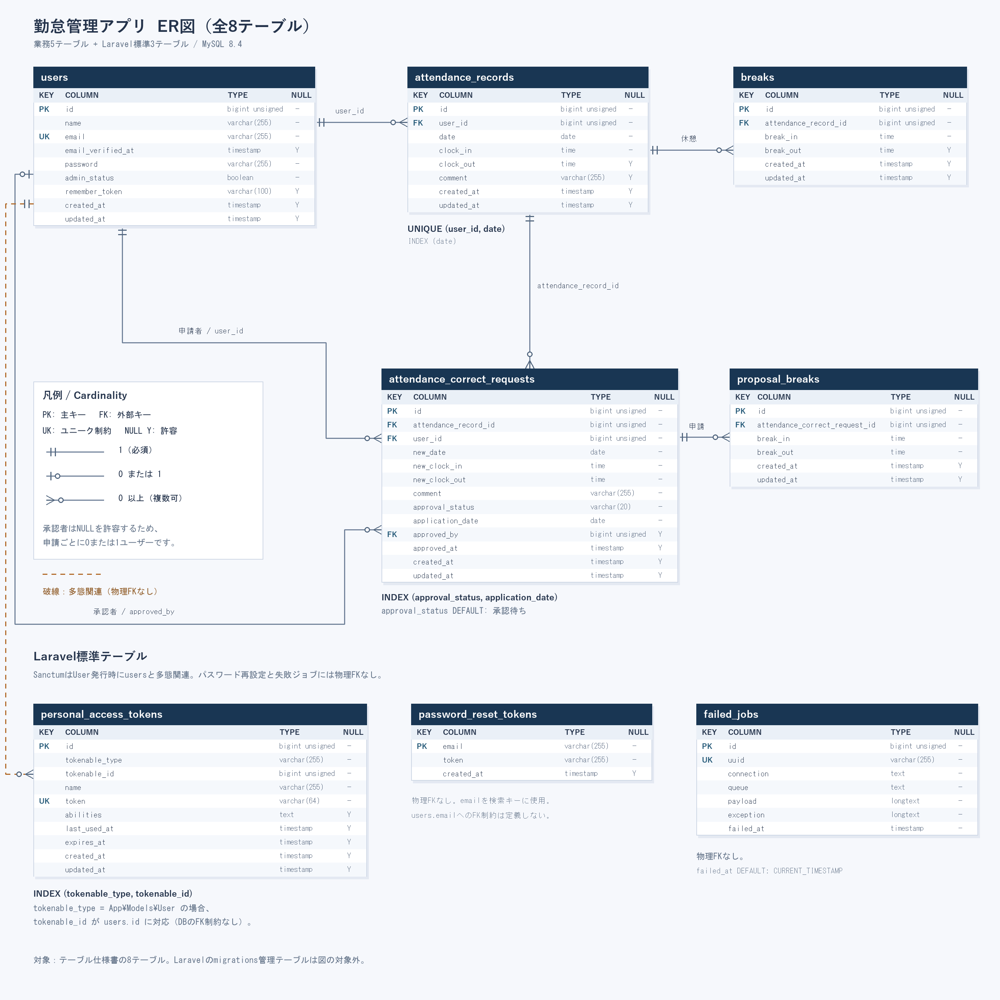

# 勤怠管理アプリ

一般ユーザーの出退勤・休憩打刻と勤怠修正申請、管理者による勤怠管理・申請承認を行うアプリケーションです。メール認証、月次勤怠CSV出力、マイ勤怠レポートにも対応しています。

## 環境構築

Docker Desktop（Docker Composeを含む）とGitを使用します。WindowsではWSL2のLinux環境でコマンドを実行してください。Docker Desktopを起動し、WSL連携を有効にしておきます。

このリポジトリには、Laravel Sail、MySQL、Mailpit、phpMyAdminの設定と、基本・応用機能用のBlade・CSS・JavaScriptが含まれています。

### 1. リポジトリを取得

```bash
git clone https://github.com/hrms-hub/attendance-app.git
cd attendance-app
```

### 2. Composer依存関係をインストール

初回はSail本体を含む `vendor/` がないため、指定のPHP 8.2用Dockerイメージで、`composer.lock` に基づく依存関係をインストールします。

```bash
docker run --rm \
  -u "$(id -u):$(id -g)" \
  -v "$(pwd):/var/www/html" -w /var/www/html \
  -e COMPOSER_CACHE_DIR=/tmp/composer_cache \
  laravelsail/php82-composer:latest \
  composer install --ignore-platform-reqs
```

参考：[Laravel Sail公式ドキュメント：既存アプリケーションのComposer依存関係のインストール](https://laravel.com/docs/10.x/sail#installing-composer-dependencies-for-existing-applications)

### 3. 環境変数を設定

```bash
cp .env.example .env
```

作成した `.env` の該当項目を、指定のDB・メール設定に変更します。

```dotenv
APP_URL=http://localhost

DB_CONNECTION=mysql
DB_HOST=mysql
DB_PORT=3306
DB_DATABASE=laravel
DB_USERNAME=sail
DB_PASSWORD=password

MAIL_MAILER=smtp
MAIL_HOST=mailpit
MAIL_PORT=1025
MAIL_USERNAME=null
MAIL_PASSWORD=null
MAIL_ENCRYPTION=null
```

Apple Silicon（M1/M2/M3/M4等）を使用する場合は、指定手順に従い、`compose.yaml` の `mysql` サービスに `platform: 'linux/amd64'` を追記してください。

### 4. Dockerコンテナをビルド・起動

Sailのエイリアスを設定し、コンテナを起動します。

```bash
alias sail='[ -f sail ] && bash sail || bash vendor/bin/sail'
sail up -d --build
```

新しいターミナルでも `sail` を使う場合は、そのターミナルで同じエイリアスを設定するか、`~/.bashrc` などに登録してください。

### 5. アプリケーションを初期化

```bash
sail artisan key:generate
sail artisan migrate --seed
```

MySQLの初回起動が完了する前に接続エラーが出た場合は、MySQLの起動完了を待ってから `sail artisan migrate --seed` を再実行してください。

シーディングで、下記の一般ユーザー2名・管理者1名と、各ユーザーの勤怠・休憩データを作成します。

一般ユーザー1（user1@example.com）には、マイ勤怠レポートの確認用データを作成します。

- 過去5か月：各月の先頭から平日15日分。出勤09:00・退勤18:00・休憩12:00〜13:00。
- 今月：1日〜17日に、通常勤務10日、残業勤務3日、遅刻2日、早退1日、長時間勤務1日。土日も含めて配置します。
- 既存勤怠のない状態で作成した場合、総労働時間744時間、総残業時間10時間、平均労働時間8時間5分、今月の遅刻2回・早退1回・長時間労働1日になります。平均労働時間は分未満を切り捨てて表示します。

その他のユーザーには、前月1日から実行日の前日までの平日に、出勤09:00・退勤18:00・休憩12:00〜13:00のデータを作成します。

同じユーザー・日付の既存勤怠と、その休憩データは上書きしません。再実行しても同じ勤怠を重複作成しません。既存データがある場合、レポートの集計結果は上記の確認用数値と異なることがあります。

### 6. フロントエンドを起動

```bash
sail npm install
sail npm run dev
```

`sail npm run dev` を実行したターミナルは起動したままにして、ブラウザでアクセスしてください。

## 使用技術（実行環境）

| 技術 | バージョン・構成 |
| --- | --- |
| PHP | 8.2（動作確認時：8.2.33） |
| Laravel | 10（動作確認時：10.50.3） |
| MySQL | 8.4（動作確認時：8.4.10） |
| Laravel Fortify | 1.36.2 |
| Vite | 5.4.21 |
| laravel-vite-plugin | 1.3.0 |
| 開発環境 | Docker / Laravel Sail |
| フロントエンド | Blade / CSS / JavaScript |
| DB管理・メール確認 | phpMyAdmin / Mailpit |

## ER図

勤怠管理に関係する5テーブルを示します。Laravel標準の `password_reset_tokens`、`failed_jobs`、`personal_access_tokens` は省略しています。



`attendance_correct_requests.user_id` は申請者、`approved_by` は承認者を参照します。承認前の `approved_by` はNULLです。勤怠の重複を防ぐため、`attendance_records` の `user_id` と `date` に複合ユニーク制約を設定しています。

## URL

| 用途 | URL |
| --- | --- |
| アプリケーション | http://localhost
| 会員登録 | http://localhost/register
| 一般ユーザーログイン | http://localhost/login
| 管理者ログイン | http://localhost/admin/login
| phpMyAdmin | http://localhost:8080
| Mailpit | http://localhost:8025
| マイ勤怠レポート（一般ユーザー・メール認証済み） | http://localhost/attendance/report |

## ログイン情報

`sail artisan migrate --seed` で作成される確認用アカウントです。

| 権限 | 名前 | メールアドレス | パスワード |
| --- | --- | --- | --- |
| 一般ユーザー | 一般ユーザー1 | user1@example.com | password |
| 一般ユーザー | 一般ユーザー2 | user2@example.com | password |
| 管理者 | 管理者ユーザー | user3@example.com | password |

一般ユーザーは `/login`、管理者は `/admin/login` からログインしてください。上記3アカウントはメール認証済みとして作成されます。

## 応用機能

- メール認証：新規登録後に認証メールを送信します。Mailpitでメールを開き、認証リンクから認証を完了してください。認証案内画面から再送信できます。
- 月次勤怠CSV出力：管理者がスタッフ別勤怠一覧で対象月を選び、CSVをダウンロードできます。
- マイ勤怠レポート：ログイン中の一般ユーザーについて、今月を含む過去6か月の労働時間・残業時間・平均労働時間と月別推移を表示します。今月の遅刻・早退・長時間労働も集計します。
